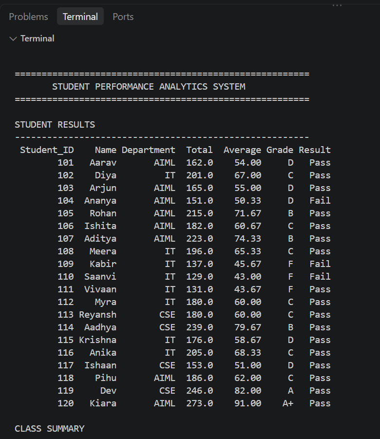
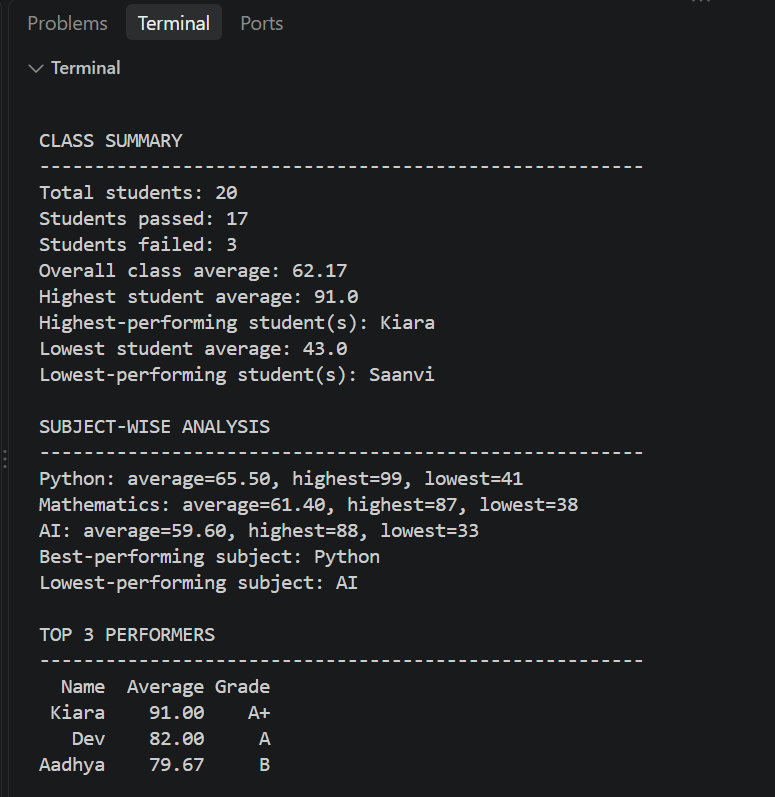
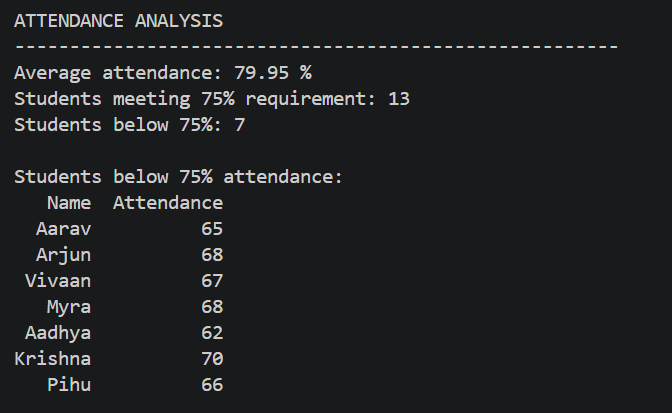
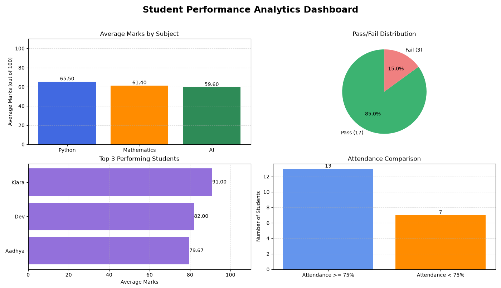

# Student Performance Analytics System

## 1. Project Title and Student Details

- **Project Title:** Student Performance Analytics System
- **Student Name:** [Your Name]
- **Course:** Python with AI
- **Department:** [Your Department]
- **Institution:** [Your College Name]

## 2. Project Objective

The objective of this project is to develop a Python-based Student Performance Analytics System that analyzes students' academic performance and attendance.

The system uses Python, NumPy, Pandas, and Matplotlib to calculate marks, averages, grades, pass/fail results, subject-wise performance, and attendance statistics. It also generates graphical visualizations to make the results easier to understand.

## 3. Technologies Used

- Python
- NumPy
- Pandas
- Matplotlib
- Visual Studio Code
- CSV dataset

## 4. Dataset Description

The project uses a CSV file named `students.csv`, containing records of 20 students.

The dataset includes the following columns:

| Column Name | Description |
|---|---|
| Student_ID | Unique student identification number |
| Name | Student's name |
| Department | Student's department |
| Python | Marks obtained in Python |
| Mathematics | Marks obtained in Mathematics |
| AI | Marks obtained in Artificial Intelligence |
| Attendance | Attendance percentage |

## 5. Implementation

### Step 1: Importing Libraries

Pandas, NumPy, and Matplotlib are imported for data processing, numerical calculations, and visualization.

### Step 2: Loading the Dataset

The program loads `students.csv` into a Pandas DataFrame.

### Step 3: Data Validation

The program checks the required columns and validates the dataset.

### Step 4: Calculating Total and Average Marks

The system calculates each student's total and average marks across Python, Mathematics, and Artificial Intelligence.

### Step 5: Assigning Grades

Grades are assigned according to average marks:

| Average Marks | Grade |
|---|---|
| 90 and above | A+ |
| 80 to below 90 | A |
| 70 to below 80 | B |
| 60 to below 70 | C |
| 50 to below 60 | D |
| Below 50 | F |

### Step 6: Pass/Fail Analysis

A student passes if they score at least 40 marks in every subject. Otherwise, the student is marked as failed.

### Step 7: Class Performance Analysis

The program calculates class statistics and identifies the highest- and lowest-performing students.

### Step 8: Subject-Wise Analysis

The system calculates the average, highest, and lowest marks for each subject.

### Step 9: Identifying Top Performers

The program identifies the top three students based on their academic performance.

### Step 10: Attendance Analysis

The system identifies students whose attendance is below 75%. Attendance status is analyzed separately from academic results.

### Step 11: Data Visualization

Matplotlib generates four charts:

- Subject-wise average marks
- Pass/fail distribution
- Top three student performers
- Student attendance comparison

## 6. Key Features

1. Loads student records from a CSV file.
2. Calculates total and average marks.
3. Assigns grades automatically.
4. Determines pass/fail status.
5. Calculates class performance statistics.
6. Performs subject-wise analysis.
7. Identifies the top three students.
8. Analyzes attendance against the 75% threshold.
9. Displays results in the terminal.
10. Generates charts using Matplotlib.

## 7. Output and Screenshots

### Terminal Output

The screenshot below shows the results displayed in the terminal.

### Matplotlib Dashboard

The screenshot below shows the graphical visualizations generated by the program.

**Note:** Save both screenshots in a folder named `screenshots` inside your project folder. Use the exact filenames shown above.

## 8. Final Outcome

The Student Performance Analytics System demonstrates how Python can be used to process and analyze student academic data.

The system calculates marks, averages, grades, pass/fail status, subject-wise statistics, top performers, and attendance information. It presents the results through terminal output and graphical visualizations.

## 9. Challenges Faced and Learning Outcomes

### Challenges Faced

- Organizing student information in a CSV dataset.
- Calculating statistics for multiple subjects.
- Implementing grading and pass/fail conditions.
- Processing data using Pandas and NumPy.
- Creating visualizations using Matplotlib.

### Learning Outcomes

Through this project, I learned how to:

- Use Python functions, loops, and conditional statements.
- Load and process CSV files using Pandas.
- Perform numerical operations using NumPy.
- Analyze data and calculate statistics.
- Create charts using Matplotlib.
- Organize a Python project into separate files.

## 10. GitHub Repository

**GitHub Repository URL:** (https://github.com/Abhishek974823/Student_performance_database)